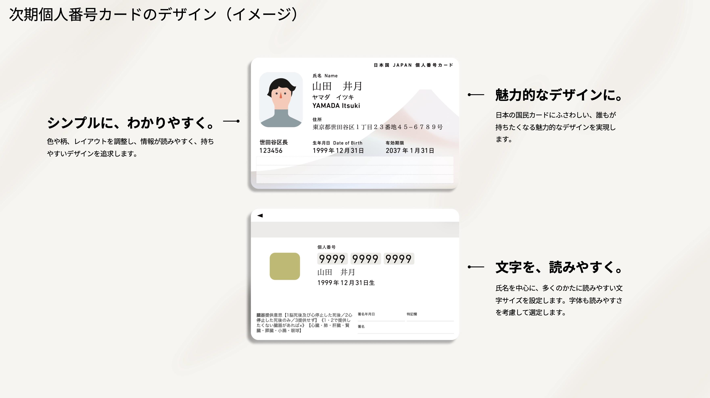

八年前我还在读本科的时候，去东京工业大学（现・东京科学大学）交换留学过[一年](../tokyo-ichinen/)，现在博士后又重返东京，真是感慨万千。虽然上次是留学签证而这次是工作签证，但大体流程都是一样的，之前办过的手续因为时间太久远很多细节都记不清了，这次还是浅浅用文字记录一下留个档吧。

0. 目录
{:toc}

## 在留资格

赴日长期居留第一步是得到日本出入国在留管理厅的许可，这份许可的全称叫「在留資格認定証明書」，有点像美国留学的 I-20；因为它英文名叫「Certificate of Eligibility」，所以常常简称 CoE。提交申请通常是由日本单位完成的，所以填完申请表之后只能乖乖等待静候佳音。听说申请人背景比较敏感的话有可能收到「質問票」，这就不知道要等到猴年马月了。我还算比较幸运，从一月中旬到三月中旬等了两个月收到 CoE，因为申请的是电子版本所以打印出邮件就好了。

<!--more-->

## 签证

收到 CoE 就可以去办签证了，跟旅行社代办的旅游签不同，长期签证需要找指定的代理机构办理，比如驻上海总领事馆有[指定名单](https://www.shanghai.cn.emb-japan.go.jp/itpr_zh/00_000897.html)，江浙几乎每个地级市都有代理点。不过我去了本市的签证服务中心才知道他们要先送到位于南京的省外事办，再由南京送到上海领事馆，相当于转包了两层。令我无语的是，比在上海办贵整整两百块钱就算了（共收 559 人民币），还说预计办理时间是三周左右，因为他们每周只去南京一趟……不过还好最后两周就拿到了。因为工作签跟旅游签不能共存，我之前的三年多次签证被戳了大大的 CANCELLED。

## 租房

收到 CoE 办理签证的同时，也可以开始申请租房了。为了头一两年的生活质量，我原本打算用旅游签证飞去东京看房现场签约的。然而租房中介告诉我没有在留卡的话人来了也没法签约，况且有不少放租的房子还有人在住没法参观，因此我还是选择了网上找房海外审查的路线。我是收到 CoE 的当天就跟提前联系的中介决定了房子、提交了申请，除了 CoE 还上传了工作单位发的录用证明书。从提交申请到审查通过就花了三天时间，到最后签完约一共花了半个月时间。

日本租房的头金跟之前在香港时不太一样，香港一般是押二付一加半个月租金作为中介费，而日本这次是押一付二加半个月中介费，再加一个月的礼金，对比香港相当于有一个月的押金变成礼金永远拿不回来了，还收了 33,000 日元换新钥匙。另外由于我租的是野村不动产管理的租赁公寓，必须找租赁担保公司（有专门面向外国人的 [GTN](https://www.gtn.co.jp)），担保费的头款是半个月租金，之后每个月收 2,000 日元，费用包含了火灾保险。简而言之，我的租房头金差不多是五个月房租的钱。

日本的公寓分为[アパート]{apartment}和[マンション]{mansion}，可以类比于香港的唐楼和洋楼，如果怀念香港私人屋苑的话可以选[タワー]{tower}[マンション]{mansion}，如果怀念公屋的话还可以选团地。如果是留学生或者研究员也可以申请[东京国际交流馆](https://www.jasso.go.jp/ryugaku/kyoten/tiec/)的宿舍，位于人工岛上，在台场南边的青海二丁目。~~喜欢日本偶像的话一定要选B栋，因为这栋的窗户正对着一年一度的东京偶像节（TIF）主会场。~~

最后友情提醒一下，日本的房子基本上不提供家具，所以最好提前买好床，预约入住那天送到公寓。

## 水电煤

因为水电煤开通也需要时间，所以我提前请租房中介帮忙打电话预约开通了。东京的自来水和污水归[东京都水道局](https://www.waterworks.metro.tokyo.lg.jp)管，电力和煤气原来是由[东京电力公司](https://www.tepco.co.jp)和[东京瓦斯公司](https://www.tokyo-gas.co.jp)垄断，但电力和煤气自由化之后可以自行选择新电力、煤气公司，我是两者都选择了东京瓦斯（福岛核事故之后对东京电力实在是没什么好感）。水和电都是到时候直接可以用，但煤气开通需要本人在场等工作人员开阀。水电煤的费用默认是寄请求书来自己拿着去便利店缴费，等有了日本银行账户之后可以改成自动转账或者信用卡扣款。

## 入境

提前处理好租房事宜之后，就可以安心赴日了。我到日本的时候已经过了三月底四月初的高峰期，所以入境队伍不算太长，就是注意入境审查的时候要走中长期在留者窗口，不要走给游客开的外国护照窗口。在入境窗口会拿到在留卡，但默认只有拼音没有汉字，要加汉字得自己去东京出入国在留管理局申请汉字氏名表记。这个管理局也位于人工岛上，附近是品川货柜码头，不通地铁，得从品川站坐公交过去。因为我的租房和劳动合同都已经遵照 CoE 用英文名签署了，所以暂时也不急着加汉字，打算明年在留卡更新的时候一并申请，正好也省了 1,600 日元的在留卡再交付手续费。

## 住民登录

在日本入住之后第一件事是住民登录，届时会往在留卡背面登记住址，办手机卡、开银行账户等等都需要载有住址的在留卡。住民登录要去市区町村的政府大楼（日语称「役所」），而我所在的新宿区还设有数家办事处（日语称「出張所」）可以避免大排长队。虽然我去的高田马场的办事处人并不多，但我交完申请还是等了将近一个小时，不知道是我同时申请的印章登录比较花时间，还是他们寻找我八年前的住民记录比较花时间。

如果是留学生的话还要办理一下国保年金，而我是雇员所以是雇主处理社保。日本的养老保险（日语称「厚生年金保険」）费率目前是固定的 18.3%，健康保险则各地每年略有不同，大致在 10% 上下，这两项都是劳资双方对半缴费，再加上雇员承担 0.6% 的失业保险，每月工资总共会扣大约 15% 的社保。

## 手机卡

日本传统上有三大运营商：[NTT docomo](https://www.docomo.ne.jp)、[SoftBank](https://www.softbank.jp/mobile/)、[au](https://www.au.com/mobile/)，它们主推的无限流量套餐月租费含税在 7,315～7,458 日元上下，而 3GB 套餐月租费在 5,478～5,665 日元上下，如果没有折扣或者返现还是相当贵的。不过 SoftBank 旗下还有子品牌 [Y!mobile](https://www.ymobile.jp)，au 母公司 KDDI 旗下还有 [UQ mobile](https://www.uqwimax.jp)，这两家 4GB 套餐月租费都只要 2,365 日元。就在前几年，[乐天](https://network.mobile.rakuten.co.jp)也加入战场成为第四大运营商。乐天的定位有点像中国第四大运营商——广电，用低价攻占市场，其套餐 3GB 之内月租费仅 1,078 日元、用到无限流量也只要 3,278 日元，不过听说乐天的信号覆盖不及三大运营商。

追求便宜的另一个选择是「格安SIM」，这种SIM卡的提供方往往是[虚拟运营商]{MVNO}，即自家没有基站而借用三大运营商的网络，因此很难保证高峰时段的网速。[IIJmio](https://www.iijmio.jp) 和 [mineo](https://mineo.jp) 大概是最有名的两家虚拟运营商，mineo 比较有意思的是它提供不限流量只限网速的套餐，比如 1.5Mbps 是 990 日元。我见过最便宜的是[日本通信](https://www.nihontsushin.com) 1GB 套餐，月租费只要 290 日元。为了与虚拟运营商竞争，三大运营商现在也推出了自己的廉价子品牌：NTT docomo 有 [irumo](https://irumo.docomo.ne.jp)，SoftBank 有 [LINEMO](https://www.linemo.jp)，而 KDDI 有 [povo](https://povo.jp)；这个 povo2.0 很有意思，跟香港的 3HK DIY 储值卡很像，没有月租费，可以自由选购各种时长的服务组合，称作[トッピング](https://povo.jp/topping-list)，尤其适合不在日本的时候保号用。

## 光纤宽带

办宽带的第一步是确认自家公寓拉了哪家的光纤，虽然听说索尼的「[NURO 光](https://www.nuro.jp)」口碑最好，但我住的公寓办都办不了。大多数公寓包括我住的都是 NTT FLET'S 的光纤线路，这个线路能选的宽带运营商非常多。因为是跟手机卡一起办的，所以我选的 SoftBank 全家桶，月租费能优惠 1,100 日元。我在 BIC CAMERA 池袋本店还返了将近五万积分，正好够买他们家 ORIGINAL BASIC 牌冰箱加洗衣机（这两个都是海尔贴牌）的新生活应援套装。「[SoftBank 光](https://www.softbank.jp/internet/sbhikari/)」面向公寓的千兆网是每月 4,730 日元（含路由器租赁费），我的公寓需要 NTT 上门施工，所以先寄来了个插着手机卡的 Wi-Fi 盒子（雅称 SoftBank Air）用来临时上网。然而令我崩溃的是，施工时我发现他们接的是电话线口，也就是说所谓的光纤只到楼，入户走的是 VDSL 百兆网……虽然延时和抖动比 SoftBank Air 好点，但网速其实并没有什么区别。

## 银行账户

开银行账户需要日本手机号，所以得放在办手机卡的下一步；但细究起来手机和宽带套餐扣费其实也需要信用卡，所以消除死锁的方法是赴日前办好国际信用卡。

日本有三大银行，恰好都是「み」开头：三菱[日联]{UFJ}银行、三井住友银行、[瑞穗]{みずほ}银行。除此之外日本邮政旗下的[邮储]{ゆうちょ}银行（邮政储蓄的日语是「[郵]{ゆう}便[貯]{ちょ}金」简称「ゆうちょ」）对外国人开户比较友好，往往是留学生的第一家银行。八年前东工大帮我开过三井住友银行的非居住者账户（居住未满六个月且无工作），只给了我一本存折，既不能刷卡购物，也不能用网上银行……我这次还是选择了三井住友银行，因为我带着雇主发的劳动条件通知书，而且基本上能跟柜员用日语交流，所以还挺顺利地就办下来了全功能的账户。开户申请全程都是用平板电脑操作的，也没用到印章，次日就电邮通知了我开设好的银行账号。

日本的银行卡跟中国略有不同的一点是，日本会区分[提款卡]{cash card}和[扣账卡]{debit card}这两个概念，前者只能在 ATM 取钱，后者则用于刷卡消费，相当于不能透支的信用卡。中国的银行卡因为都接入了银联网络，所以相当于整合了提款卡和扣账卡的功能。日本近年来也开始推出这种一体型卡，在开户的时候最好告诉店员自己需要「デビット付きキャッシュカード」，否则仍有可能拿到单体型的提款卡。三井住友银行现在在推的 [Olive](https://www.smbc.co.jp/kojin/olive/) 就是这种一体型卡，甚至还能通过手机应用把扣账模式切换成信用模式。

## 个人编号卡

开完银行账户基本上就走完移居日本第一周的必经之路了，但还有个证件现在不是必需但以后迟早得办：个人编号卡，通称「[マイ]{My}[ナンバー]{Number}[カード]{Card}」，是日本政府从2016年开始推行的身份证。有了个人编号卡之后，很多行政手续都能通过 [マイナポータル](https://myna.go.jp) 线上办理。从海外移居日本后三十天内可以申请[特急发行](https://www.kojinbango-card.go.jp/apprec/apply/express_apply/)，原则上一周就能收到，不过这个得去政府大楼不能去办事处。

根据日本政府的[公告](https://www.gov-online.go.jp/article/202407/entry-6238.html)，2024年12月2日起健康保险证已不再发行，取而代之的是「マイナ保険証」，也就是拿登录过的个人编号卡当健康保险证用。话虽如此，就算没有个人编号卡，也能收到健康保险资格确认书，目前资格确认书能继续当原来的健康保险证用。

根据警察厅交通局的[公告](https://www.npa.go.jp/bureau/traffic/r4kaisei_main.html)，2025年3月24日起个人编号卡可以作为驾照使用，即「マイナ免許証」。

根据出入国在留管理厅的 [Q&A](https://www.moj.go.jp/isa/11_00051.html)，2026年6月21日前将推行在留卡和个人编号卡的一体化，一张「特定在留カード」即可实现两张卡的功能。因为个人编号卡不是强制的，所以办理此卡也不是在留者的义务。

另外根据[会议资料](https://www.digital.go.jp/councils/mynumber-card-renewal)，日本数字厅考虑将于2026年引入第二代个人编号卡，感觉新版设计比现在好看多了！

